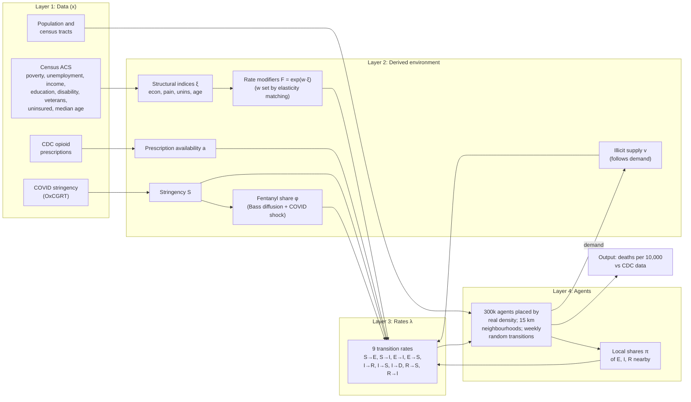
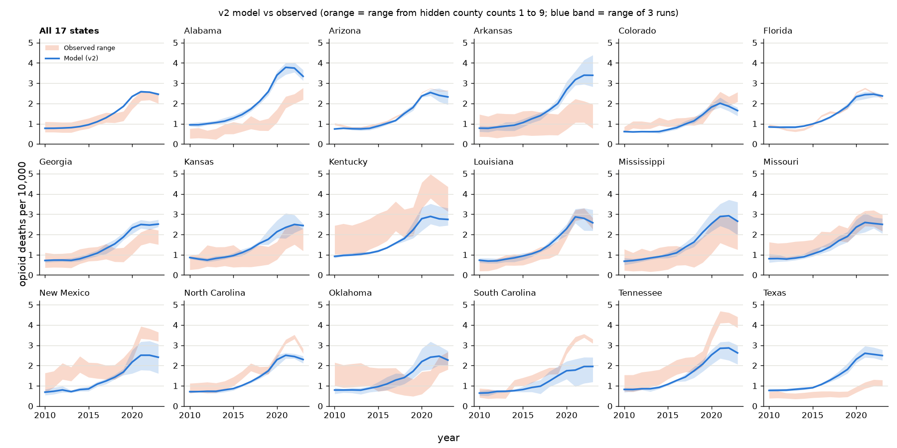
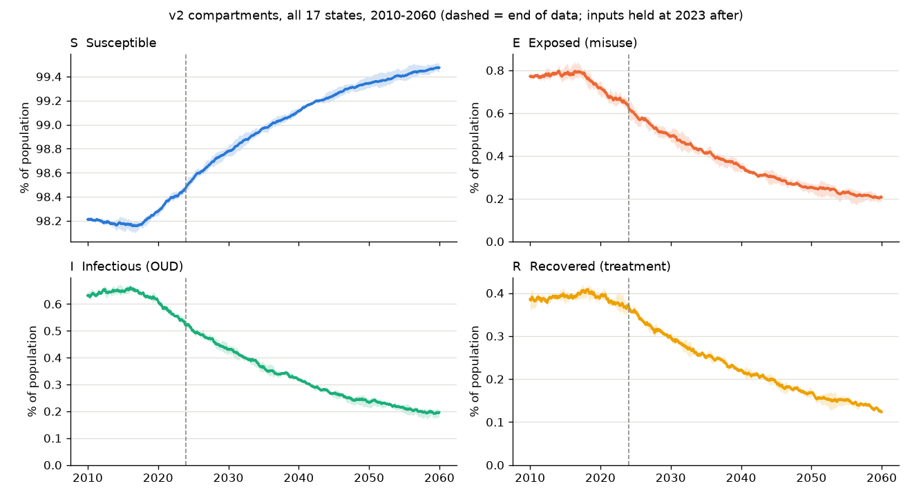
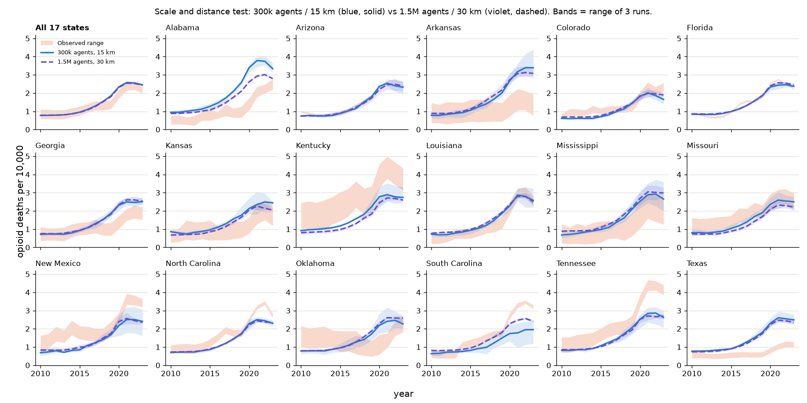

# A Spatial Agent-Based Model of Opioid Overdose in 17 Southern States

**Model version 2** (2026-11-05). Code: `experiment/engine/`. Viewer: `experiment/app.py`. Papers: [../reference/](../reference/README.md), cited as [R01]…[R19].

---

## 0. The model in one picture

Each person (agent) is in one of four states: **S**usceptible, **E**xposed (misusing opioids), **I**nfectious (opioid use disorder, OUD) or **R**ecovered (in treatment). People move between states at random times. How fast depends on (a) where they live and (b) who is around them. Overdose deaths are the only thing we can compare with real data.

The model is built in four layers. Each layer is computed only from the layers before it.

*(The chart renders on GitHub, or in VS Code with the "Markdown Preview Mermaid Support" extension.)*

There are two feedback loops: agents change their neighbours' rates (π), and the number of users pulls illicit supply (v).

---

## 1. Layer 1: Data (the raw environment variables x)

Everything is county-level (1,538 counties in AL, AZ, AR, CO, FL, GA, KS, KY, LA, MS, MO, NM, NC, OK, SC, TN, TX), yearly unless noted. Files live in `data/`.

| Symbol           | Variable                                                              | Unit   | Years                                                    | Source                                               |
| ---------------- | --------------------------------------------------------------------- | ------ | -------------------------------------------------------- | ---------------------------------------------------- |
| $x^{pov}$      | Persons below poverty line                                            | %      | 2012–23                                                 | ACS 5-year                                           |
| $x^{unemp}$    | Unemployment rate                                                     | %      | 2012–23                                                 | ACS 5-year                                           |
| $x^{inc}$      | Median household income                                               | USD    | 2012–23                                                 | ACS 5-year                                           |
| $x^{nohs}$     | Adults 25+ without high-school diploma                                | %      | 2012–23                                                 | ACS 5-year                                           |
| $x^{bach}$     | Adults 25+ with bachelor's or more                                    | %      | 2012–23                                                 | ACS 5-year                                           |
| $x^{dis}$      | Population with a disability                                          | %      | 2012–23                                                 | ACS 5-year                                           |
| $x^{vet}$      | Adult veterans                                                        | %      | 2012–23                                                 | ACS 5-year                                           |
| $x^{unins}$    | Without health insurance                                              | %      | 2012–23                                                 | ACS 5-year                                           |
| $x^{age}$      | Median age                                                            | years  | 2012–23                                                 | ACS 5-year                                           |
| $x^{Rx}$       | Opioid prescriptions per 100 residents                                | Rx/100 | 2010–18 county; 2019–23 extended by the national trend | CDC dispensing-rate maps                             |
| $x^{str}_s(t)$ | COVID policy stringency (per **state**, daily)                  | 0–100 | 2020–22                                                 | Oxford COVID-19 Government Response Tracker (OxCGRT) |
| $P_c$, tracts  | County population; 33,696 census tracts (population, centre, area)    | people | 2010–23; 2020                                           | SRDDRC file; Census 2020 + Gazetteer                 |
| $Y_c(y)$       | **Observed** opioid overdose deaths (counts 1–9 hidden by CDC) | count  | 2010–23                                                 | SRDDRC / CDC WONDER                                  |

Notes:

- **Early ACS years:** 2010–11 have no comparable county ACS, so they reuse the 2012 values.
- **Prescriptions after 2018:** the 2019 CDC county page looks like a method change, so county prescription rates stop at 2018.
- **Projections:** after the last data year, every input is held at its last value. Stringency is 0 after 2022.

---

## 2. Layer 2: Derived environment (computed from Layer 1)

### 2.1 Structural indices ξ

Each Census variable is standardized over all counties and years together, so real time trends are kept. The result is clipped at ±3 SD:
$z = \text{clip}\big((x - \bar x)/s_x,\,-3,\,3\big)$.

The z-scores are then grouped into **four indices**. Each is re-standardized to mean 0 and SD 1.

| Index           | Formula                                                            | Meaning                                       |
| --------------- | ------------------------------------------------------------------ | --------------------------------------------- |
| $\xi^{econ}$  | mean of $z^{pov}, z^{unemp}, z^{nohs}, -z^{\log inc}, -z^{bach}$ | Economic precarity                            |
| $\xi^{pain}$  | mean of $z^{dis}, z^{vet}$                                       | Pain and injury burden (drives prescriptions) |
| $\xi^{unins}$ | $z^{unins}$                                                      | Lack of insurance (barrier to treatment)      |
| $\xi^{age}$   | $z^{age}$                                                        | Older population                              |

### 2.2 Rate modifiers F

Each rate θ (section 3) is multiplied by

$$
F_\theta(c,t) = \exp\Big(\sum_k w_{\theta,k}\,\xi^k_c(t)\Big)
$$

In an average county (all ξ = 0), F = 1, so the baseline rate keeps its literature value.

**How the weights w are set: elasticity matching.**

1. Start from sign priors taken from the literature (which way each index pushes each rate).
2. For each index, scale its whole row by one factor so that a +1 SD change in that index changes the model's long-run death rate by a literature-sized amount:
   - econ: +15% (unemployment alone gives about +6%/SD [R05]; the economic channel is weaker than the drug environment [R04])
   - pain: +20%
   - unins: +10%
   - age: weights left at their priors (net effect about −4%)

Final weights (per SD):

|       | β (S→E) | γ (S→I) | σ (E→I) | ε (E→S) | ζ (I→R) | μ (I→D) | δ (R→S) | ρ (R→I) |
| ----- | --------- | --------- | --------- | --------- | --------- | --------- | --------- | --------- |
| econ  | +0.016    |           | +0.016    | −0.010   | −0.010   |           | −0.010   | +0.010    |
| pain  |           | +0.213    |           |           |           |           |           |           |
| unins |           |           |           |           | −0.049   | +0.033    |           |           |
| age   | −0.10    | +0.20     |           |           |           | +0.10     |           |           |

Why this step matters: the unscaled priors implied that +1 SD of economic precarity multiplies deaths ×4.5. They pushed 26% of the population into counties where drug use became self-sustaining, which caused the Texas/Mississippi runaway in v1 (section 7).

### 2.3 Drug availability: three parts [R09]

| Symbol           | What                                               | How it is computed                         | Feeds            |
| ---------------- | -------------------------------------------------- | ------------------------------------------ | ---------------- |
| $a_c(t)$       | Prescription availability (Rx per person per year) | $x^{Rx}/100$, interpolated between years | S→I             |
| $v_c(t)$       | Illicit supply index (1 = level at start)          | Dynamic, see below                         | S→E, E→I, R→I |
| $\varphi_s(t)$ | Fentanyl share of the illicit supply, per state    | Dynamic, see below                         | I→D             |

**Illicit supply follows demand.** Supply drifts toward local demand (the share of users nearby), spills over to neighbouring counties, and has random market noise:

$$
dv_c = \Big[\kappa_v\big(v^*_c - v_c\big) + D_v\textstyle\sum_{c'}W_{cc'}(v_{c'}-v_c)\Big]dt + \sigma_v v_c\,dB_c,
\qquad v^*_c = \Big(\frac{\text{demand}_c}{\text{demand at start}}\Big)^{\theta_d}
$$

Here demand = $i_c + \vartheta_E e_c$ (OUD share + 0.3 × misuse share), shrunk toward the regional mean for small counties. $W_{cc'} \propto e^{-d_{cc'}/100\,\text{km}}$.

**Fentanyl spreads like a new product (Bass diffusion), and COVID speeds it up:**

$$
\frac{d\varphi_s}{dt} = \big(p_\varphi + p_{cov}\,S_s(t) + q_\varphi\,\varphi_s\big)(1 - \varphi_s), \qquad \varphi_s = 0 \text{ before } 2013
$$

In words:

- $p_\varphi$ is spontaneous introduction.
- $q_\varphi\varphi$ is copying from markets that already switched.
- $p_{cov}S$ is the extra push from pandemic supply disruption. It ends when restrictions end, but the shift it caused is **permanent**, because φ does not go back down.

### 2.4 COVID stringency

$S_s(t) = x^{str}_s(t)/100 \in [0,1]$, by state and day. It enters in two places:

- the fentanyl push above;
- an isolation effect on the death rate (people using alone with nobody to give naloxone): $\times\, e^{w_{iso} S}$.

---

## 3. Layer 3: Transition rates λ (computed from Layers 1–2 and the agents)

### 3.1 The nine rates

Each rate is a **baseline × availability term × modifier F**, plus a **peer term** where the mechanism is social. Agent $i$ lives in county $c$ and state $s$. $\pi^X_i$ is the share of class X within 15 km of the agent (section 4).

| # | Move | Rate $\lambda$ (per person per year)                                        | Mechanism                                                                         |
| - | ---- | ----------------------------------------------------------------------------- | --------------------------------------------------------------------------------- |
| 1 | S→E | $\beta^0\,(\pi^I_i + \vartheta_E\pi^E_i)\;v_c\;F_\beta$                     | Starting misuse through people nearby, easier when supply is high [R02, R13, R18] |
| 2 | S→I | $\gamma_{Rx}\,\chi\,a_c\;F_\gamma$                                          | Addiction starting from a prescription [R01]                                      |
| 3 | E→I | $\sigma^0\,v_c^{0.5}\;F_\sigma$                                             | Misuse progresses to OUD                                                          |
| 4 | E→S | $\epsilon^0\;F_\epsilon$                                                    | Misuser stops                                                                     |
| 5 | I→R | $\zeta^0 F_\zeta + \gamma_p\,\pi^R_i$                                       | Enters treatment; peers in recovery help [R01]                                    |
| 6 | I→S | $\nu^0$                                                                     | Quits without treatment                                                           |
| 7 | I→D | $\big[\mu_H(1-\varphi_s) + m_F\mu_H\,\varphi_s\big]\,e^{w_{iso}S_s}\,F_\mu$ | Overdose: a mix of the pre-fentanyl and fentanyl death rates [R09, R12]           |
| 8 | R→S | $\delta^0\;F_\delta$                                                        | Lasting recovery                                                                  |
| 9 | R→I | $\big(\rho^0 v_c^{0.5} + \rho_p\,\pi^I_i\big)\,F_\rho$                      | Relapse: from supply, and from users nearby [R01]                                 |

Each death is immediately replaced by a newborn S in the same county, so the population size stays fixed.

### 3.2 Which inputs drive which rate

| Rate | econ | pain | unins | age | Rx $a$ | supply $v$ | fentanyl $\varphi$ | COVID $S$ | neighbours $\pi$ |
| ---- | ---- | ---- | ----- | --- | -------- | ------------ | -------------------- | ----------- | ------------------ |
| S→E | ●   |      |       | ●  |          | ●           |                      |             | ●                 |
| S→I |      | ●   |       | ●  | ●       |              |                      |             |                    |
| E→I | ●   |      |       |     |          | ●           |                      |             |                    |
| E→S | ●   |      |       |     |          |              |                      |             |                    |
| I→R | ●   |      | ●    |     |          |              |                      |             | ●                 |
| I→S |      |      |       |     |          |              |                      |             |                    |
| I→D |      |      | ●    | ●  |          |              | ●                   | ●          |                    |
| R→S | ●   |      |       |     |          |              |                      |             |                    |
| R→I | ●   |      |       |     |          | ●           |                      |             | ●                 |

### 3.3 Baseline values

Status: **L** = literature, **A** = assumption, **C** = calibrated to a target that is *not* deaths, **F** = fitted to deaths.

| Symbol                                   | Value              | Status | Basis                                                               |
| ---------------------------------------- | ------------------ | ------ | ------------------------------------------------------------------- |
| $\beta^0$                              | 0.841              | C      | New misuse = 0.66% of people per year [R01]                         |
| $\gamma_{Rx}$                          | 0.0074             | L      | Addiction rate per opioid-therapy year [R01]                        |
| $\chi$                                 | 0.032              | C      | Chosen with β⁰ so that OUD prevalence = 0.6% [R01]                |
| $\sigma^0,\ \epsilon^0$                | 0.08, 0.92         | A      | About 1 year of misuse; 8% progress to OUD                          |
| $\zeta^0$                              | 0.5                | L      | Treatment entry [R01]                                               |
| $\nu^0$                                | 0.05               | A      | Slow untreated remission                                            |
| $\delta^0$                             | 0.1                | L      | Successful treatment [R01]                                          |
| $\rho^0,\ \rho_p$                      | 0.7, 0.2           | L      | About 90% relapse within a year [R01]                               |
| $\gamma_p$                             | 0.1                | A      | Peer recovery                                                       |
| $\vartheta_E$                          | 0.3                | A      | Misusers recruit less than people with OUD                          |
| $\mu_H$                                | 0.0127             | L      | Overdose deaths out of treatment, 12.7 per 1,000 person-years [R12] |
| $m_F$                                  | 3.88               | F      | Fentanyl market makes overdose 3.9× deadlier                       |
| $p_\varphi,\ q_\varphi$                | 0.0128, 0.6        | F, A   | Fentanyl introduction and copying rates                             |
| $p_{cov}$                              | 1.33               | F      | COVID push on fentanyl introduction                                 |
| $w_{iso}$                              | 0.14               | F      | COVID isolation effect on overdose (×1.07 at stringency 0.5)       |
| $\theta_d,\ \kappa_v,\ D_v,\ \sigma_v$ | 0.1, 1.0, 0.2, 0.1 | A      | Supply follows demand within about one year                         |

---

## 4. Layer 4: Agents and the simulation

**Placement.** N agents (default 300,000, about 1 agent per 450 people) are split across counties by population. Within each county, an agent is placed in a census tract drawn by population, at a random spot within the tract's area. Agent density therefore follows real population density.

**Neighbours.** Two agents interact if they are within **ρ = 15 km**. For speed, this is computed on a 5 km grid (each class is counted per cell, then summed over a 15 km disc). The local share of class X is

$$
\pi^X_i = \frac{\#\{X \text{ within } 15\text{ km}\} + k_0\, x_c}{\#\{\text{agents within } 15\text{ km}\} + k_0}, \qquad k_0 = 20
$$

The $k_0$ "pseudo-agents" at the county average stop rural agents with very few neighbours from swinging wildly. Because π is a share, results don't depend on N, only the noise does.

**One weekly step** (Δt = 1/52 year):

1. Update the environment: ξ, a, S, v, φ.
2. Count E, I and R around every agent to get π.
3. Compute each agent's rates λ. The agent leaves its state with probability $1 - e^{-\Lambda\Delta t}$, where Λ is the sum of its rates. It goes to destination j with probability $\lambda_j/\Lambda$ (competing random clocks).
4. Count deaths, and rebirth those agents as S at a new spot in their county.

**Start.** Every agent begins at the long-run state of an average county (s, e, i, r = 98.3%, 0.66%, 0.60%, 0.38%). The model then runs 10 years under the 2010 environment, so each place settles before 2010.

**Ensemble.** M independent runs (default 3) give a mean and a range.

---

## 5. How we know the engine is right (analytical checks)

**Averaged equations.** For one well-mixed county, the expected shares follow four differential equations (`engine/calibrate.py`). The agent model converges to them as N grows. Calibration solves their long-run state, so prevalence = 0.6% and new misuse = 0.66%/yr.

**No drug-free endpoint.** As long as prescriptions exist ($a > 0$), S→I keeps creating cases, so drug use never fully dies out [R01].

**Contact reproduction number.** This is how many new misusers one user creates through contact alone, counting all relapse cycles:

$$
\mathcal R_c = \beta^0\Big[\frac{\sigma^0}{\sigma^0+\epsilon^0}\,T_I + \frac{\vartheta_E}{\sigma^0+\epsilon^0}\Big], \qquad T_I = \frac{1}{\zeta^0+\nu^0+\mu_H - \zeta^0\frac{\rho^0}{\rho^0+\delta^0}} \approx 8 \text{ years}
$$

In an average county, $\mathcal R_c = 0.79$. This is close to 1, so a county whose modifiers raise it by about 25% becomes self-sustaining. That is why the weights must be sized carefully (section 2.2).

**Tipping point in supply.** If illicit supply responds too strongly to demand ($\theta_d > 0.2$), the long-run state becomes unstable and drug use grows on its own. We use $\theta_d = 0.1$.

---

## 6. Comparing with data and fitting

**Model deaths.** Expected deaths per county-year = the sum, over the year, of each OUD agent's death rate × Δt, scaled to the real population ($P_c/n_c$). This has the same average as the counted deaths but much less noise.

**Score.** Comparison is done at the **state-year** level. CDC hides county counts of 1–9, so each observed state total is an interval (hidden counts as 1 → hidden counts as 9). The score is the probability, under a negative binomial with the model's mean, that the total falls in that interval. County-level scores are not usable: at 0.6% prevalence a 300-agent county holds about 2 OUD agents.

**What is fitted to deaths.** Only the four lethality parameters: $m_F$, $p_\varphi$, $p_{cov}$, $w_{iso}$. Everything else is literature, assumption, or calibrated to non-death targets.

**Why they can be fitted without rerunning agents.** Fentanyl and COVID act only on the death rate. Death is a small exit from OUD (about 4%/yr, compared with about 60%/yr for all exits), so the OUD trajectory barely depends on these parameters. Expected deaths can be recomputed from a saved run in seconds (`engine/fit_lethality.py`). A full rerun with the fitted values confirms the result.

**Held-out tests.**

| Fit on                 | Tested on                            | Result                                                                                                            |
| ---------------------- | ------------------------------------ | ----------------------------------------------------------------------------------------------------------------- |
| 2010–2021, all states | 2022–23                             | Worse on the test years. Isolation got a big weight (0.98) and deaths dropped in 2022–23 when restrictions ended |
| 2010–2023, 12 states  | 5 unseen states (TN, TX, CO, GA, LA) | Better on the unseen states; parameters almost unchanged                                                          |
| 2010–2023, all states | (final)                              | $m_F$ 3.88, $p_\varphi$ 0.013, $p_{cov}$ 1.33, $w_{iso}$ 0.14                                             |

**Finding.** Once the years after restrictions are included, the data prefer the **permanent supply shock** ($p_{cov}$) over the temporary isolation effect ($w_{iso}$ shrinks from 0.98 to 0.14). Deaths stayed high in 2022–23 after restrictions ended, so the model explains the COVID jump as fentanyl taking over the supply faster, not as people being alone.

---

## 7. Results (v2)

Runs `v2_baseline` (2010–2023) and `v2_projection_2060`: 300,000 agents × 3 runs each. Open them in the viewer, or see the figures below.

### 7.1 What changed from v1 and why

| Change                                                                                                                     | Reason                                                                        | Effect                                                        |
| -------------------------------------------------------------------------------------------------------------------------- | ----------------------------------------------------------------------------- | ------------------------------------------------------------- |
| Density factor removed (contacts no longer scale with crowding)                                                            | Big metros became self-sustaining                                             | Necessary, but not sufficient on its own                      |
| Weights set by elasticity matching                                                                                         | Unscaled priors: econ ×4.5 per SD; 26% of the population in runaway counties | Texas 2021: 4.7 → 2.6 (observed about 1.0); no state runs away |
| COVID added (stringency → fentanyl push + isolation)                                                                      | Every state's deaths jumped ×1.4–2.2 in 2019–21                            | See 7.2                                                       |
| Fentanyl timing and lethality fitted                                                                                       | It was a guess and arrived too early                                          | 2019: 2.01 → 1.86 (still above the 1.61 upper bound)         |
| Removed: data nudging, empty cohesion/treatment indices, hub exposure, fentanyl's spatial copying term, county-level score | Inactive (no data), or unusable                                               | Same model behaviour, simpler                                 |

### 7.2 Deaths: region and states

| | v1 | v2 |
|---|---|---|
| Fit score (log-likelihood per state-year, higher is better) | −70.3 | **−2.44** |
| Region: years inside the observed range | 11 / 14 | 10 / 14 (2018–20 slightly high) |
| States: average share of years inside their observed range | — | 35% |

What the figure shows:

- **Region-wide**, the shape is right: flat until 2014, rising with fentanyl, a jump in 2020, and a plateau in 2021–23.
- **The COVID jump is now there in every state**, because the push on fentanyl comes from each state's own stringency.
- **States fit well:** Arizona, Florida, Colorado, Louisiana and Missouri follow their data closely.
- **States too high:** Texas (about 2.5×), Alabama and Arkansas.
- **States too low:** Kentucky, Tennessee, South Carolina and New Mexico.
- **The model's states are too alike.** Its 2021 values span 1.8–3.8; the observed values span 1.0–4.9. Census-based modifiers sized by the literature are too weak to create the real differences between states (section 8).

### 7.3 Compartments, projected to 2060

After 2023, every input is held at its 2023 value:

| Region, % of population | 2010 | 2023 | 2040 | 2059 |
|---|---|---|---|---|
| E (misuse) | 0.77 | 0.65 | 0.34 | 0.21 |
| I (OUD) | 0.63 | 0.54 | 0.31 | 0.19 |
| R (treatment) | 0.38 | 0.37 | 0.21 | 0.13 |
| Deaths per 10,000 | 0.77 | 2.45 | 1.47 | 0.91 |

- **No state runs away** in v2. In v1, Texas and Florida grew while the rest faded.
- **No state dies out** (lowest: 4 OUD agents in any state-week). OUD declines slowly everywhere, at about the 40-year timescale from section 5, because prescriptions keep falling and stay low.
- **Deaths fall more slowly than OUD prevalence**, because the fentanyl share stays at its maximum.

### 7.4 Scale and distance test: 1.5M agents with a 30 km radius

Run `v3_N1.5M_rho30` uses 5× the agents (about 1 per 90 people) and twice the radius. **Everything else is the same as `v2_baseline`**, including the four fitted parameters, which were not refitted. Both runs are kept.

| | v2: 300k, 15 km | v3: 1.5M, 30 km |
|---|---|---|
| Region, 2021 deaths per 10,000 | 2.58 | 2.54 |
| OUD prevalence 2010 → 2023 | 0.63% → 0.54% | 0.64% → 0.53% |
| Run-to-run SD of state rates | 0.172 | **0.075** |
| Spread of state values, 2021 | 1.77–3.78 | 1.98–3.07 |
| Fit (log-likelihood per state-year) | −2.44 | **−2.23** |
| State-years inside the observed range | 35% | 34% |
| Counties with no agent | 1 | 0 |

- **The region-wide result does not depend on scale.** This is expected: rates use the *share* of neighbours in each state, so more agents should not change the mean.
- **Noise fell by the predicted amount.** With 5× the agents, noise should shrink by $\sqrt5 = 2.24$; it did, 0.172/0.075 = 2.3.
- **States moved closer together.** Alabama fell by 0.85 and South Carolina rose by 0.70 (2021), both toward their data, which is why the fit score improved. The wider radius averages over more people, so local clusters matter less.
- **The core gap is unchanged:** Texas is still too high, Kentucky and Tennessee still too low. Scale and radius are not the missing ingredient.
- **Caveat:** agent count and radius changed together. The noise drop matches the agent count; the narrowing between states is most likely the radius, but a 1.5M / 15 km run is needed to separate them.
- Runtime: 4–7 min per run of 1.5M agents. (One run took 105 min, probably because the machine went to sleep.)

---

## 8. Limitations and next steps

1. **States are now too similar.** With literature-sized weights, Census variables explain little of the gap between states. The real gaps (TN/KY/NM high, TX/OK low) probably reflect *when* fentanyl reached each market. Fentanyl share by state is driven only by COVID stringency today, not by real supply data. Next: synthetic-opioid (T40.4) death shares or NFLIS reports by state.
2. **Four parameters are fitted to deaths.** The held-out-state test supports them, but 2020–23 are not a clean out-of-sample test.
3. **Small counties are noisy.** At 300k agents, county maps are mostly noise below about 1,000 agents per county. 1.5M agents cut noise by √5 (section 7.4); still read results at state level.
4. **Not modelled:** deaths in treatment (R→D, 5–10× lower than untreated [R12]), migration, stimulant co-use, naloxone distribution.
5. **Viewer:** editing parameters from the page is planned.

---

## Appendix A: symbol index

| Symbol                           | Meaning                                                         | Layer |
| -------------------------------- | --------------------------------------------------------------- | ----- |
| $x$                            | Raw data variable                                               | 1     |
| $z$, $\xi$                   | Standardized variable; structural index                         | 2     |
| $w$, $F$                     | Weight; rate modifier $e^{w\cdot\xi}$                         | 2     |
| $a$, $v$, $\varphi$, $S$ | Prescriptions; illicit supply; fentanyl share; COVID stringency | 2     |
| $\lambda$                      | Transition rate                                                 | 3     |
| $\beta^0 \ldots \rho^0$        | Baseline rates                                                  | 3     |
| $\pi^X$                        | Share of class X within 15 km                                   | 4     |
| $\rho$                         | Interaction radius (15 km)                                      | 4     |
| $k_0$                          | Pseudo-agents for sparse neighbourhoods                         | 4     |
| $N$, $M$, $\Delta t$       | Agents; runs per ensemble; time step                            | 4     |
| $\mathcal R_c$, $T_I$        | Contact reproduction number; total time in OUD                  | 5     |
| $m$, $Y$                     | Deaths per 10,000 (model); observed deaths                      | 6     |
